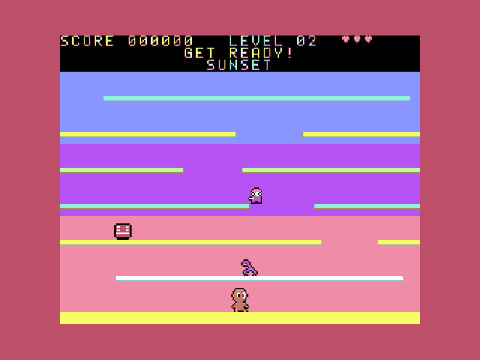
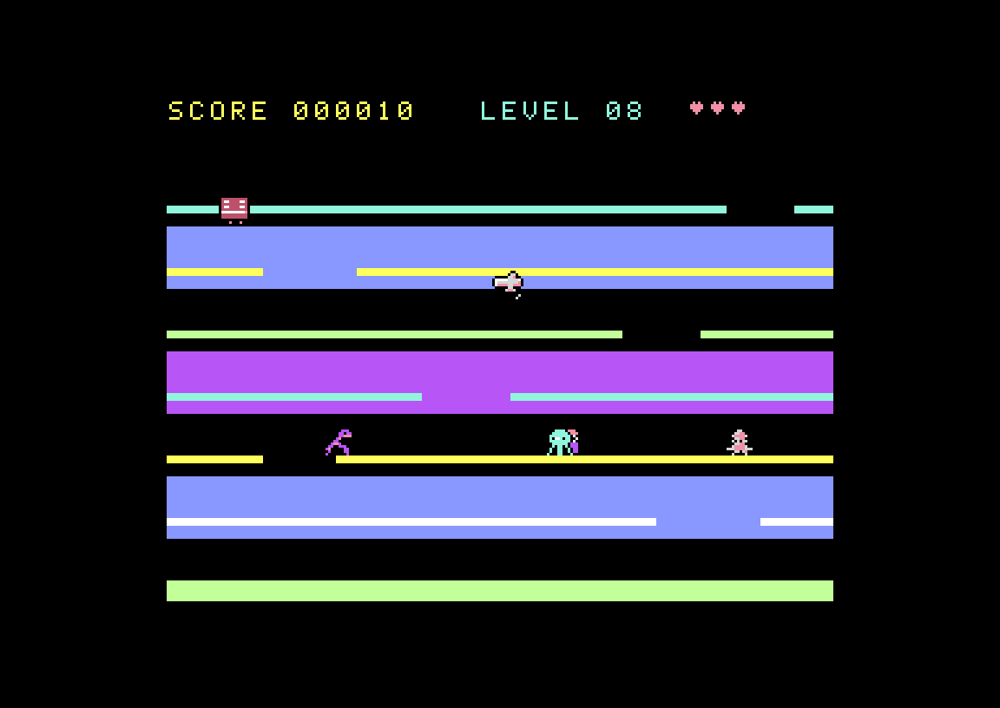
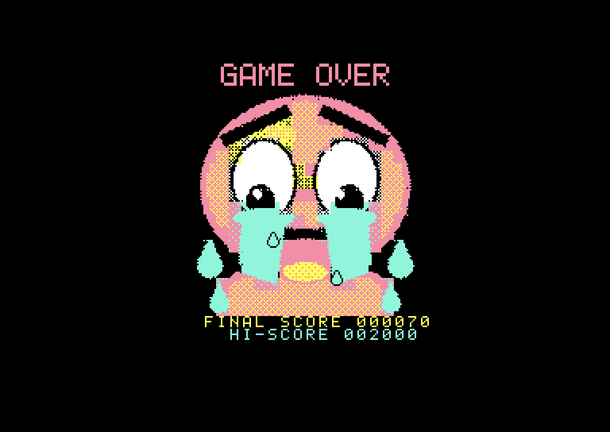

# Jumping Jim — Commodore 64



**Jumping Jim** is a platform game in the spirit of the classic *Jumping Jack*: Jim has
to climb seven floors by jumping through gaps that keep sliding sideways, without
bumping his head on the ceiling and while dodging eight kinds of baddies. This repository
holds the **complete Commodore 64 port**, written in 6502 assembly, and a structure
designed to take the game to other platforms.

🎬 **44-second gameplay video:** [`promo/jumpingjim_c64_gameplay.mp4`](promo/jumpingjim_c64_gameplay.mp4)

| | | |
|---|---|---|
|  |  |  |
|  |  |  |

## Play

1. Download the `.d64` from [Releases](../../releases), or build it with `make` (see below).
2. On a C64 or in VICE: `LOAD"*",8,1` and `RUN`. The same file runs on PAL, NTSC and
   Drean machines: it detects the system and keeps the speed and the tuning of the
   music right on each.

**Controls:** keyboard **O/Z** left, **P/X** right, **Q/SPACE** jump,
**SPACE/RETURN** start · joystick in **port 2 or 1** (up or fire = jump) ·
**F1** on the title screen switches the extra effects (backgrounds and screen shake) on or off.

**New in this port:**
- **Top-10 high score table**, with arcade-style initials. It is saved on the disk as `JJ.HISCORES`.
- **"Transporter" effect:** enemies falling towards the ground floor dematerialise and reappear at the top.
- **Tuned movement:** Jim and the stopped robot stay in sync with the sliding floors.
- **SID music:** the original AY music converted to the SID, plus a Retro Informática Paraguay splash screen.
- **A picture behind every level** (can be switched off with F1): a starry night with a
  big moon, a sunset over the sea, the deep sea, a castle under a blood moon, misty
  mountains, a city at dusk, a volcano and the northern lights, one for each colour scheme.
- **Screen shake** (can be switched off with F1): the screen shakes when Jim bumps his head
  or lands after a fall, and the baddies give a little hop. Only the picture changes; the
  game itself plays exactly as before.
- **Blinking "PRESS SPACE OR FIRE"** instead of the yellow inverse banner of the original.
- **PAL, NTSC and Drean** in one program, at the same speed and in tune on all three
  (the credits screen shows the system found).

Technical details in [`platforms/c64/README.md`](platforms/c64/README.md).

## Build

Requirements: `python3` (+ Pillow), the [ACME](https://sourceforge.net/projects/acme-crossass/)
cross-assembler and VICE (`c1541`, `x64sc`). On Manjaro:

```sh
# ACME is not in the Manjaro/Arch repositories: build it from source
git clone https://github.com/meonwax/acme
make -C acme/src && sudo cp acme/src/acme /usr/local/bin/
sudo pacman -S vice python-pillow    # VICE provides c1541 and x64sc
```

To publish releases you also need the GitHub CLI: `sudo pacman -S github-cli && gh auth login`.

```sh
make                        # all ports (currently: C64) → platforms/c64/build/jumpingjim.d64 / .prg
make assets                 # regenerate assets/ from the original .nex
make -C platforms/c64 run   # try it in VICE
make -C platforms/c64 promo # autopilot build (for recording demos)
make -C platforms/c64 check # automated tests in headless VICE (see docs/testing.md)
make release VERSION=c64-1.1.1 # publish releases/jumpingjim-c64-1.1.1.zip on GitHub
```

## Repository layout (ready for more ports)

```
original/        the original ZX Spectrum Next binary (.nex): the reference
tools/           extract.py dumps all game data to a neutral format; release.sh publishes releases;
                 vice_harness.py drives VICE for the automated tests; lzpack.py packs data;
                 backgrounds/ draws the level pictures
releases/        ready-made release zips (build one with: make -C platforms/c64 dist VERSION=X.Y.Z)
assets/          neutral data: jumpingjim.json (tables, levels, music, effects, logo, texts),
                 font, voice (4-bit and WAV), sprites as PNG, backgrounds/ (the
                 level pictures, made for this port)
lib/rip-intro/   the Retro Informática Paraguay intro (logo, fade, converter), a module
                 shared by RIP's games; tools/update_rip_intro.sh copies a new version
docs/            game-spec.md (complete rules and logic), porting-guide.md, testing.md
platforms/c64/   the Commodore 64 port: src/, tools/convert_c64.py, tests/, Makefile
promo/           promotional screenshots, video and GIF
```

Want to port it to another machine? Start with [`docs/porting-guide.md`](docs/porting-guide.md)
and [`docs/game-spec.md`](docs/game-spec.md).

## About

- **Original game:** [*Jumping Jim* for the ZX Spectrum Next](https://roman126.itch.io/jumping-jim-zx-spectrum-next)
  by **roman126**, an AI-assisted reimagining of the classic *Jumping Jack*
  (Imagine Software, 1983) for the ZX Spectrum. The design, graphics, music and original
  code are his. This port is published **with his permission** — thank you, roman126!
- **Commodore 64 port:** Carlos Zayas ([@czayas](https://github.com/czayas)), developed
  with the assistance of artificial intelligence (Claude, by Anthropic): reverse engineering
  of the Z80 code, translation to 6502, and conversion of graphics and sound.
- **Retro Informática Paraguay (RIP):** a Paraguayan community devoted to classic
  computers. Follow their videos on their [YouTube channel](https://www.youtube.com/@retroinfopy).

## License

Free software under the [MIT License](LICENSE), AI-assisted. The original game content
(design, graphics, music) belongs to roman126 and is used with permission; see
[`NOTICE.md`](NOTICE.md) for the details.
