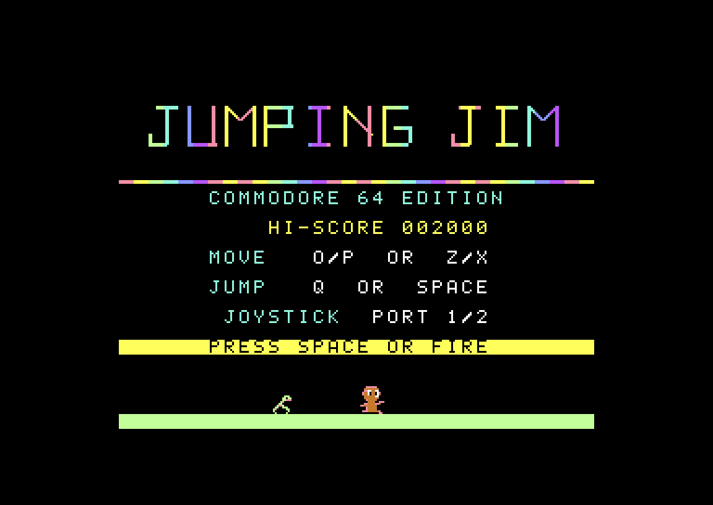
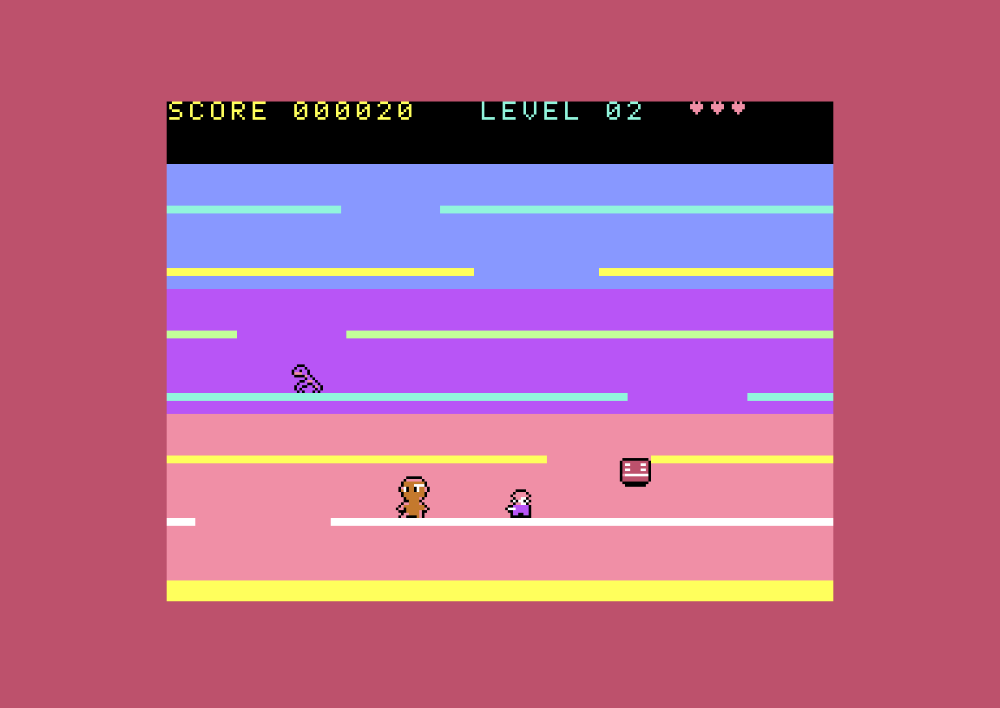
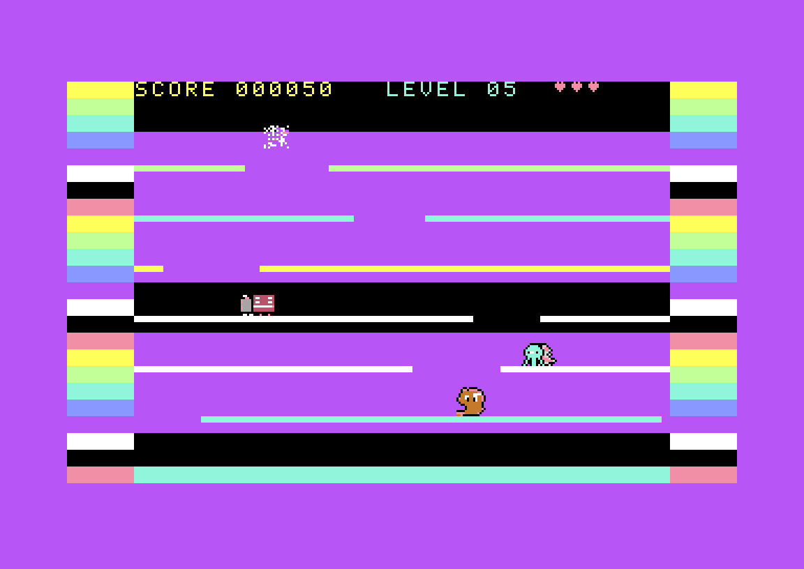
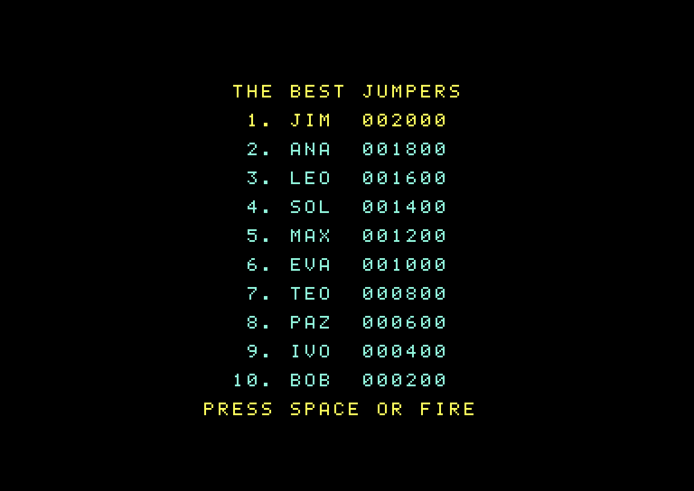

# Jumping Jim — Commodore 64


**Jumping Jim** es un juego de plataformas en la línea del clásico *Jumping Jack*: Jim tiene
que subir siete pisos saltando por huecos que se desplazan, sin golpearse la cabeza contra
el techo y esquivando a ocho tipos de enemigos. Este repositorio contiene el **port completo
para Commodore 64**, escrito en ensamblador 6502, y una estructura pensada para llevarlo a
otras plataformas.

> *English summary below.*

🎬 **Video de 44 segundos:** [`promo/jumpingjim_c64_gameplay.mp4`](promo/jumpingjim_c64_gameplay.mp4)

| | | |
|---|---|---|
|  |  |  |
|  |  |  |

## Jugar

1. Compilá con `make` (ver más abajo) o usá el `.d64` de la sección *Releases* si está publicado.
2. En el C64 o en VICE: `LOAD"*",8,1` y `RUN`.

**Controles:** teclado **O/Z** izquierda, **P/X** derecha, **Q/ESPACIO** saltar,
**ESPACIO/RETURN** empezar · joystick en **puerto 2 o 1** (arriba o fuego = saltar).

**Novedades del port:**
- **Tabla de los 10 mejores puntajes**, con iniciales al estilo arcade. Se graba en el disco como `JJ.HISCORES`.
- **Efecto "transportador":** los enemigos que caen hacia la planta baja se desmaterializan y reaparecen arriba.
- **Movimiento ajustado:** Jim y el robot detenido se mueven sincronizados con los pisos deslizantes.
- **Música SID:** la música original del chip AY convertida al SID, y una presentación con el logo de Retro Informática Paraguay.

Detalles técnicos en [`platforms/c64/README.md`](platforms/c64/README.md).

## Compilar

Requisitos: `python3` (+ Pillow), [`acme`](https://sourceforge.net/projects/acme-crossass/) y
VICE (`c1541`, `x64sc`). En Manjaro: `sudo pacman -S acme vice`.

```sh
make            # todos los ports (hoy: C64) → platforms/c64/build/jumpingjim.d64 / .prg
make assets     # regenerar assets/ desde el .nex original
make -C platforms/c64 run     # probarlo en VICE
make -C platforms/c64 promo   # versión con piloto automático (para grabar demos)
```

## Estructura (pensada para portar a otras plataformas)

```
original/        binario original del ZX Spectrum Next (.nex): la referencia
tools/extract.py extrae todos los datos del .nex a un formato neutral
assets/          datos neutrales: jumpingjim.json (tablas, niveles, música, efectos,
                 logo, textos), fuente, voz (4 bits y WAV), sprites en PNG, logo RIP
docs/            game-spec.md (reglas y lógica completas), porting-guide.md
platforms/c64/   el port de Commodore 64: src/, tools/convert_c64.py, Makefile
promo/           capturas, video y GIF promocionales
```

¿Querés portarlo a otra máquina? Empezá por [`docs/porting-guide.md`](docs/porting-guide.md)
y [`docs/game-spec.md`](docs/game-spec.md).

## Acerca de

- **Juego original:** [*Jumping Jim* para ZX Spectrum Next](https://roman126.itch.io/jumping-jim-zx-spectrum-next),
  de **roman126**. Es una reinterpretación, hecha con asistencia de IA, del clásico *Jumping Jack*
  (Imagine Software, 1983) para ZX Spectrum. El diseño, los gráficos, la música y el código
  original le pertenecen. Este port se publica **con su permiso**. ¡Gracias, roman126!
- **Port para Commodore 64:** Carlos Zayas ([@czayas](https://github.com/czayas)), desarrollado
  con la asistencia de IA (Claude, de Anthropic): ingeniería inversa del código Z80,
  traducción a 6502 y conversión de gráficos y sonido.
- **Retro Informática Paraguay (RIP):** comunidad paraguaya dedicada a las computadoras
  clásicas. Seguí sus videos en su [canal de YouTube](TODO-ENLACE-YOUTUBE).

---

## English summary

A complete **Commodore 64 port** of *Jumping Jim*, roman126's AI-assisted ZX Spectrum Next
take on *Jumping Jack*. The game was reverse-engineered from the original `.nex` binary and
rewritten in 6502 assembly (ACME). Extras over the original: a disk-saved top-10 high score
table, a "transporter" effect for enemies, floor-synchronised movement and SID music.

The repository is organised for further ports: `tools/extract.py` dumps all game data to
platform-neutral `assets/`, and `docs/game-spec.md` documents the complete game logic.

Original game by **roman126** —
<https://roman126.itch.io/jumping-jim-zx-spectrum-next> — ported with his permission.
C64 port by Carlos Zayas, with AI assistance, for **Retro Informática Paraguay**.
